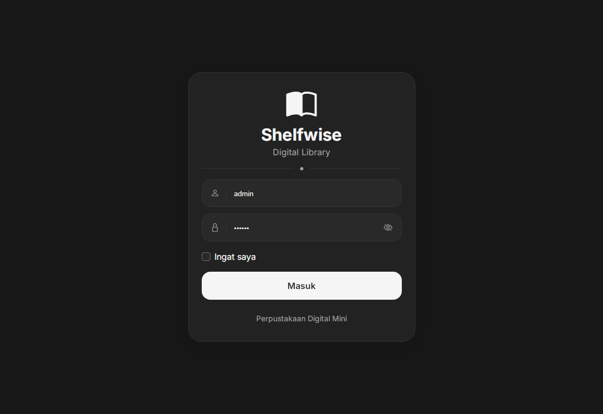
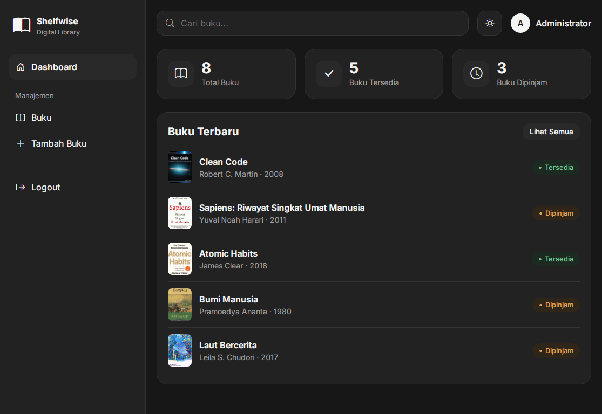
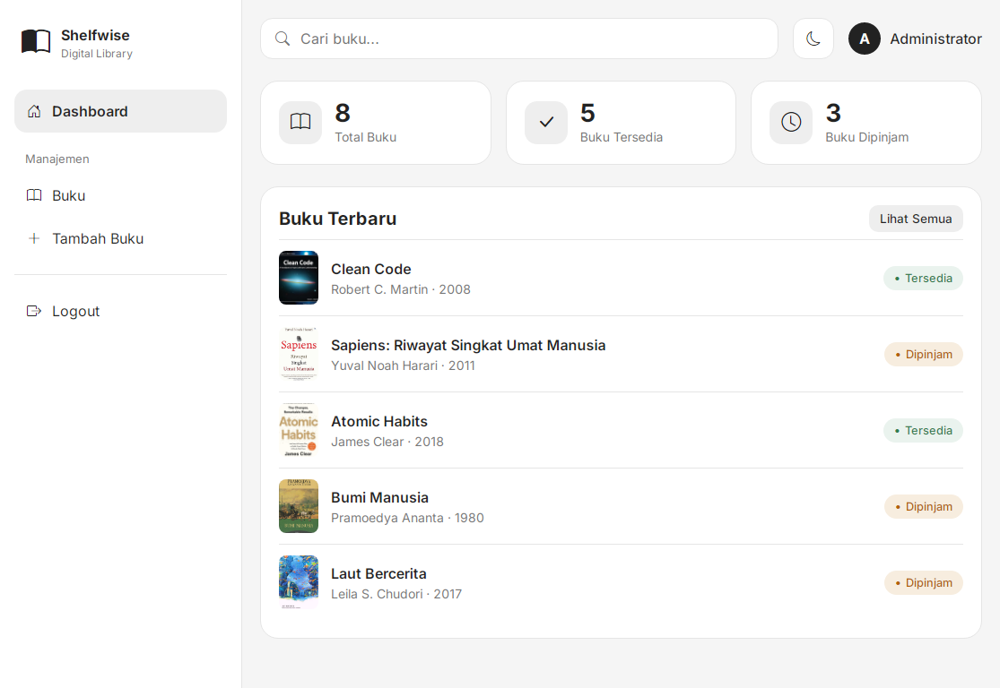
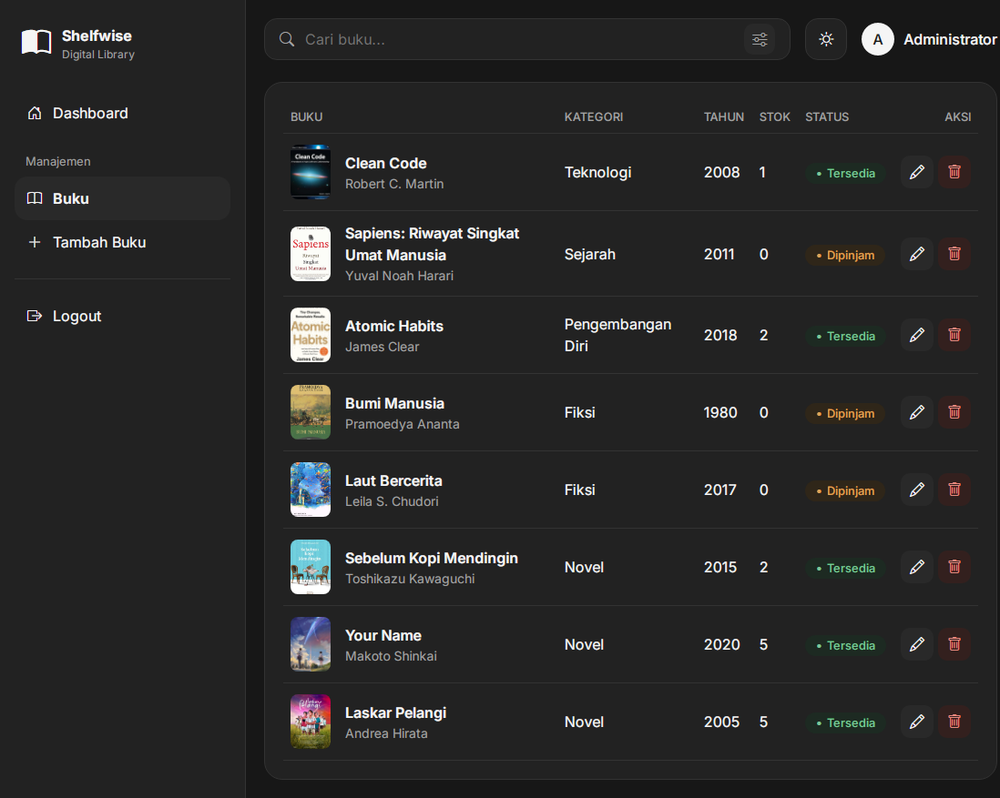
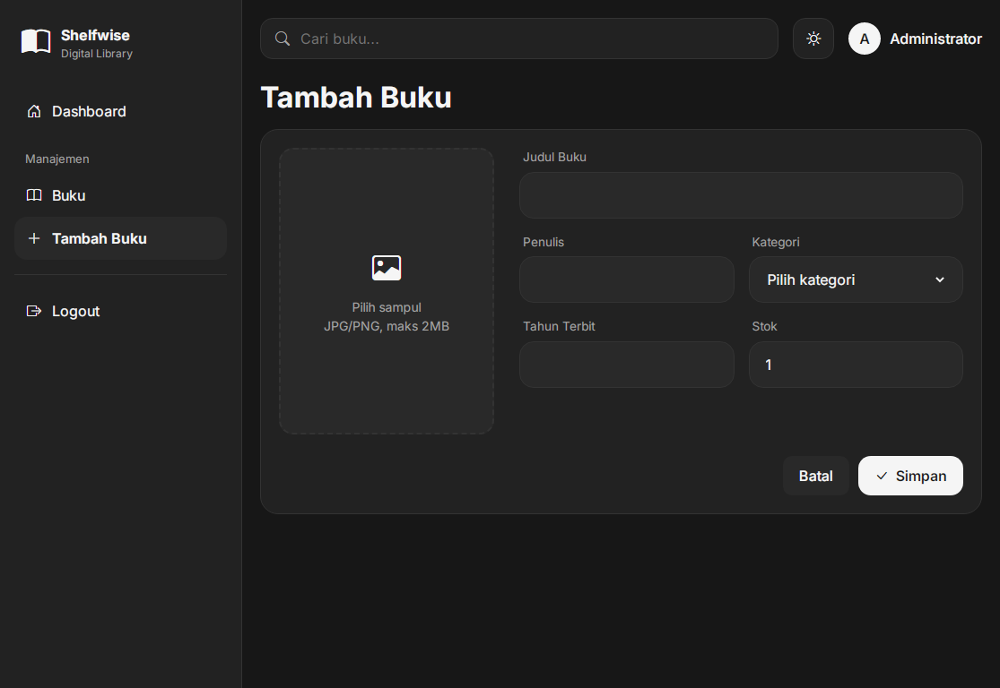
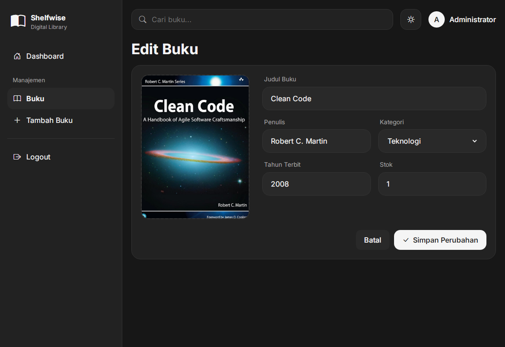
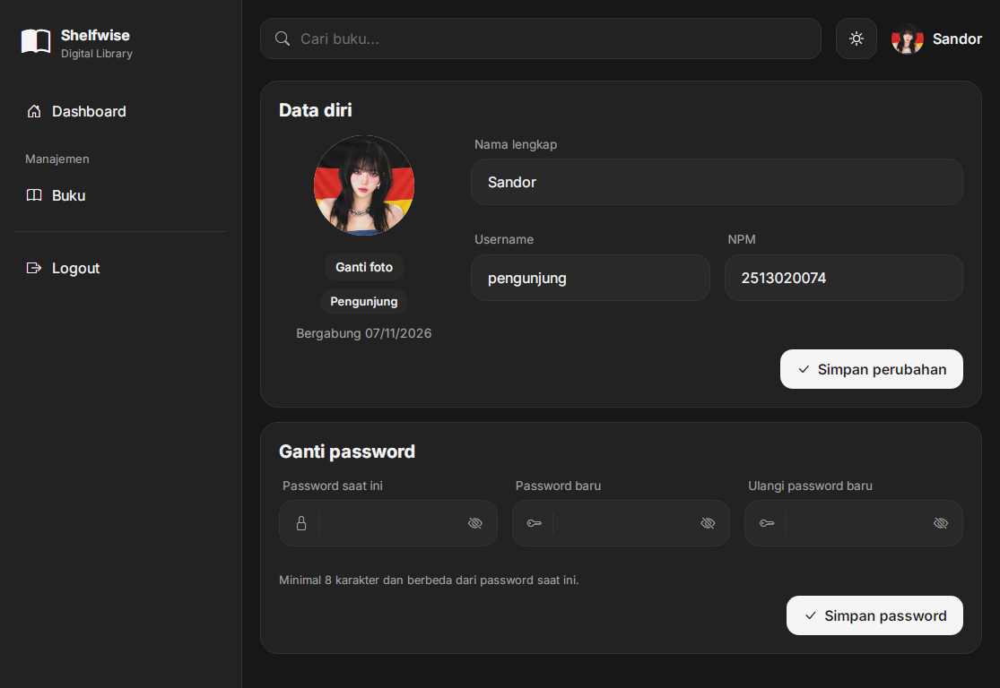
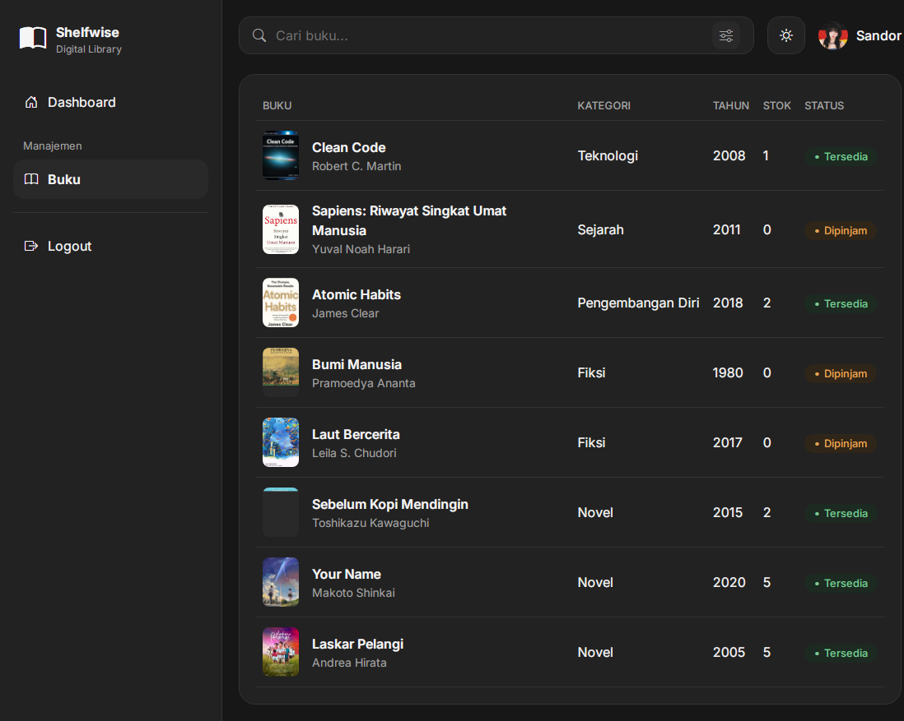

# Shelfwise Digital Library

Aplikasi web perpustakaan mini untuk mengelola data buku: login dengan session dan cookie, CRUD buku lengkap dengan upload sampul, pencarian dan filter, serta pembagian hak akses admin dan pengunjung. Dibangun dengan **PHP Native**, **MySQL**, **Bootstrap 5**, dan sedikit JavaScript.

| | |
|---|---|
| **Nama** | Leonardo Yanuarianto |
| **NPM** | 2513020074 |
| **Program Studi** | Sistem Informasi, Universitas Nusantara PGRI Kediri |
| **Mata Kuliah** | Pemrograman Web |
| **Tugas** | Tugas Terstruktur: Pengembangan Sistem Informasi Perpustakaan Digital Mini |

- **Video demo:** https://youtu.be/usy0qDokm4g

---

## Daftar Isi

1. [Fitur](#fitur)
2. [Kesesuaian dengan Ketentuan Tugas](#kesesuaian-dengan-ketentuan-tugas)
3. [Tampilan Aplikasi](#tampilan-aplikasi)
4. [Teknologi](#teknologi)
5. [Struktur Folder](#struktur-folder)
6. [Struktur Database](#struktur-database)
7. [Alur Sistem](#alur-sistem)
8. [Keamanan](#keamanan)
9. [Instalasi](#instalasi)
10. [Akun Demo](#akun-demo)
11. [Proses Pengembangan](#proses-pengembangan)
12. [Tantangan dan Solusi](#tantangan-dan-solusi)
13. [Pengembangan Lanjutan](#pengembangan-lanjutan)
14. [Referensi dan Kredit](#referensi-dan-kredit)

---

## Fitur

**Autentikasi dan hak akses**
- Login dengan form POST, password disimpan sebagai hash.
- Session untuk membatasi akses halaman; pengguna yang belum login dialihkan ke halaman login.
- "Ingat saya": cookie berisi username selama 30 hari.
- Logout menghapus session dan cookie.
- Dua peran: **admin** (kelola buku) dan **pengunjung** (hanya melihat dan mencari).

**Manajemen buku (CRUD)**
- Tambah, lihat, ubah, dan hapus buku.
- Upload sampul (JPG atau PNG, maksimal 2MB) dengan pratinjau sebelum disimpan.
- Mengganti sampul menghapus file lama; menghapus buku ikut menghapus file sampulnya.
- Status buku dihitung dari stok: stok lebih dari 0 berstatus **Tersedia**, selain itu **Dipinjam**.
- Kategori dipilih dari daftar tetap, bukan diketik bebas.

**Pencarian dan penyaringan**
- Pencarian langsung (tanpa menekan Enter) berdasarkan judul, penulis, atau kategori.
- Filter berdasarkan status dan kategori.

**Tampilan**
- Mode terang dan gelap, mengikuti pengaturan perangkat dan bisa diganti manual (pilihan tersimpan di `localStorage`).
- Responsif: tabel di layar lebar, baris yang bisa digeser (Edit dan Hapus) di HP, sidebar menjadi menu geser.

**Profil**
- Ubah nama, username, dan foto profil.
- Data tambahan menurut peran: NPM untuk pengunjung, email dan nomor HP untuk admin.
- Ganti password dengan verifikasi password lama.

---

## Kesesuaian dengan Ketentuan Tugas

| Ketentuan | Implementasi | File utama |
|---|---|---|
| Login dengan form POST | Verifikasi `password_verify`, pesan error umum | `login.php`, `process/login.php` |
| Session | `session_start`, `session_regenerate_id`, guard di setiap halaman | `includes/auth.php`, `includes/functions.php` |
| Cookie "Remember Me" | Cookie `ingat_username`, `HttpOnly`, `SameSite=Lax`, 30 hari | `process/login.php` |
| Logout | Hapus session dan cookie, alihkan ke login | `process/logout.php` |
| Create | Form tambah buku dan simpan dengan prepared statement | `pages/add-book.php`, `process/tambah.php` |
| Read | Tabel HTML dengan pencarian dan filter | `pages/books.php` |
| Update | Ubah data dan opsi ganti sampul | `pages/edit-book.php`, `process/edit.php` |
| Delete | Hapus data lalu hapus file dengan `unlink` | `process/hapus.php` |
| Upload file (jpg/png, maks 2MB) | Cek ukuran dan tipe dari isi file, nama acak | `uploadSampul()` di `includes/functions.php` |
| Percabangan label status | `if/else` pada `statusBuku()` | `includes/functions.php` |
| PHP Native tanpa framework | Tanpa framework backend | seluruh proyek |
| Koneksi `mysqli` atau PDO | PDO dengan prepared statement | `config/database.php` |
| UI menarik (CSS framework dan JS) | Bootstrap 5.3 dan JavaScript vanilla | `assets/` |
| Repositori, SQL, README | GitHub, `database/db_perpustakaan.sql`, dokumen ini | |

Perbedaan penamaan dengan struktur yang direkomendasikan: halaman login dipisah menjadi `login.php` (tampilan) dan `process/login.php` (proses), sedangkan `index.php` menjadi pengarah ke login atau dashboard. File koneksi bernama `config/database.php` (setara `koneksi.php`).

---

## Tampilan Aplikasi

### Login


### Dashboard (mode gelap)


### Dashboard (mode terang)


### Daftar buku (admin)


### Tambah buku


### Edit buku


### Profil


### Tampilan pengunjung (tanpa tombol tambah, edit, hapus)


---

## Teknologi

| Bagian | Teknologi |
|---|---|
| Backend | PHP 8.1+ (Native), PDO |
| Database | MySQL / MariaDB |
| Frontend | Bootstrap 5.3, Bootstrap Icons, CSS variables, JavaScript vanilla |
| Font | Inter (Google Fonts) |
| Versi kontrol | Git dan GitHub |
| Lingkungan pengembangan | GitHub Codespaces |

---

## Struktur Folder

```
shelfwise-library/
├── assets/
│   ├── css/style.css            # tema terang/gelap (CSS variables) dan semua komponen
│   └── js/app.js                # ganti tema, tampil/sembunyi password, pencarian langsung,
│                                #   pratinjau gambar, modal hapus
├── config/
│   ├── database.example.php     # contoh konfigurasi (database.php tidak ikut Git)
│   └── database.php             # koneksi PDO dan BASE_URL (dibuat sendiri)
├── database/
│   └── db_perpustakaan.sql      # skema dan data contoh
├── includes/                    # komponen yang dipakai ulang
│   ├── auth.php                 # guard: wajib login
│   ├── functions.php            # session, flash, validasi, upload, peran
│   ├── header.php / footer.php  # kerangka HTML
│   ├── sidebar.php              # sidebar dan topbar
│   ├── layout_end.php
│   ├── form-buku.php            # form tambah dan edit (satu komponen)
│   ├── filter-buku.php          # menu filter status dan kategori
│   ├── stat-cards.php           # kartu statistik dashboard
│   └── modal-hapus.php          # modal konfirmasi hapus
├── pages/                       # halaman (wajib login)
│   ├── dashboard.php
│   ├── books.php                # tabel buku, pencarian, filter
│   ├── add-book.php
│   ├── edit-book.php
│   └── profile.php
├── process/                     # pemrosesan form (POST) dan endpoint
│   ├── login.php  logout.php
│   ├── tambah.php  edit.php  hapus.php
│   ├── profil.php  ganti-password.php
│   └── cari.php                 # JSON untuk pencarian langsung
├── screenshots/                 # gambar untuk dokumentasi
├── uploads/                     # sampul buku dan foto profil
├── index.php                    # pengarah ke login atau dashboard
├── login.php                    # halaman login
└── README.md
```

---

## Struktur Database

Database: `db_perpustakaan` (utf8mb4).

### Tabel `users`

| Kolom | Tipe | Keterangan |
|---|---|---|
| `id` | INT, PK, AUTO_INCREMENT | |
| `username` | VARCHAR(50), UNIQUE | untuk login |
| `password` | VARCHAR(255) | hash `password_hash` |
| `nama` | VARCHAR(100) | |
| `role` | ENUM('admin','pengunjung') | default `pengunjung` |
| `npm` | VARCHAR(20), NULL | khusus pengunjung |
| `email` | VARCHAR(100), NULL | khusus admin |
| `telepon` | VARCHAR(20), NULL | khusus admin |
| `foto` | VARCHAR(255), NULL | nama file di `uploads/` |
| `created_at` | TIMESTAMP | |

### Tabel `buku`

| Kolom | Tipe | Keterangan |
|---|---|---|
| `id` | INT, PK, AUTO_INCREMENT | |
| `judul` | VARCHAR(150) | |
| `kategori` | VARCHAR(50) | harus ada di daftar `KATEGORI` |
| `penulis` | VARCHAR(100) | |
| `tahun_terbit` | YEAR | 1901 sampai tahun depan |
| `stok` | INT, default 0 | 0 sampai 9999 |
| `sampul` | VARCHAR(255), NULL | nama file di `uploads/` |
| `created_at` | TIMESTAMP | |

Status ketersediaan **tidak disimpan**, tetapi dihitung dari `stok` setiap kali ditampilkan, sehingga tidak bisa tidak sinkron dengan datanya.

---

## Alur Sistem

### Login, session, dan cookie

1. Form login mengirim `username` dan `password` lewat POST ke `process/login.php`.
2. Server mencari user dengan prepared statement, lalu mencocokkan password dengan `password_verify`.
3. Jika cocok: `session_regenerate_id(true)` (mencegah session fixation), lalu `user_id`, `nama`, `role`, dan `foto` disimpan di session.
4. Jika "Ingat saya" dicentang, cookie `ingat_username` (hanya username, bukan password) disimpan 30 hari dan dipakai untuk mengisi form login berikutnya.
5. Setiap halaman di `pages/` memuat `includes/auth.php`; tanpa session, pengguna dialihkan ke login.
6. Logout mengosongkan session, menghapus cookie session dan cookie "Ingat saya".

### Tambah, ubah, dan hapus buku

- **Tambah:** validasi isian, validasi sampul, lalu `INSERT`. Jika query gagal, file yang sudah terunggah dihapus kembali.
- **Ubah:** sampul baru (jika ada) divalidasi dan disimpan, data di database diperbarui, **baru setelah itu** file sampul lama dihapus. Urutan ini menjaga agar sampul lama tidak hilang jika update gagal.
- **Hapus:** hanya lewat POST dengan modal konfirmasi. Data dihapus dari database lebih dulu, lalu file sampulnya.

### Hak akses

| | Admin | Pengunjung |
|---|---|---|
| Dashboard, daftar buku, pencarian, filter | Ya | Ya |
| Tambah, ubah, hapus buku dan upload sampul | Ya | Tidak |
| Profil dan ganti password sendiri | Ya | Ya |

Pembatasan dilakukan **di server** (`requireAdmin()` pada halaman dan proses tambah, ubah, hapus), bukan hanya dengan menyembunyikan tombol. Pengunjung yang membuka alamat halaman admin langsung dialihkan dengan pesan peringatan.

---

## Keamanan

- Password disimpan dengan `password_hash` dan diperiksa dengan `password_verify`; pesan gagal login tidak membedakan username atau password yang salah.
- Semua query memakai **prepared statement** PDO (aman dari SQL injection), dan filter status memakai daftar putih.
- Semua keluaran ke HTML melewati fungsi `e()` (`htmlspecialchars`) untuk mencegah XSS; hasil pencarian langsung disusun dengan `textContent`.
- Upload: ukuran dibatasi 2MB, tipe diperiksa dari **isi file** dengan `finfo` (bukan ekstensi), nama file diacak, dan penghapusan file memakai `basename`.
- Operasi yang mengubah data hanya menerima POST.
- Validasi dilakukan ulang di server (kategori, tahun, stok, username, NPM), tidak hanya di browser.
- `config/database.php` masuk `.gitignore` sehingga kredensial database tidak ikut ke repositori.

---

## Instalasi

**Prasyarat:** PHP 8.1 atau lebih baru dengan ekstensi `pdo_mysql` dan `fileinfo`, serta MySQL atau MariaDB.

1. **Ambil kode**

   ```bash
   git clone https://github.com/the1975/shelfwise-library.git
   cd shelfwise-library
   ```

2. **Buat database dan user**

   ```bash
   sudo service mariadb start   # di XAMPP cukup jalankan MySQL dari panel
   mysql -u root -p
   ```

   ```sql
   CREATE DATABASE db_perpustakaan CHARACTER SET utf8mb4 COLLATE utf8mb4_unicode_ci;
   CREATE USER 'shelfwise'@'localhost' IDENTIFIED BY 'GANTI_PASSWORD_INI';
   GRANT ALL PRIVILEGES ON db_perpustakaan.* TO 'shelfwise'@'localhost';
   EXIT;
   ```

3. **Impor database** (berisi tabel, data buku contoh, dan dua akun demo)

   ```bash
   mysql -u shelfwise -p db_perpustakaan < database/db_perpustakaan.sql
   ```

4. **Buat file konfigurasi**

   ```bash
   cp config/database.example.php config/database.php
   ```

   Lalu isi `DB_USER` dan `DB_PASS` di `config/database.php`. Jika proyek ditaruh di subfolder (misalnya `htdocs/shelfwise-library` pada XAMPP), ubah `BASE_URL` menjadi `'/shelfwise-library'`.

5. **Jalankan**

   ```bash
   php -S localhost:8000
   ```

   Buka `http://localhost:8000`. Pastikan folder `uploads/` dapat ditulis oleh server.

---

## Akun Demo

| Peran | Username | Password |
|---|---|---|
| Admin | `admin` | leon27 |
| Pengunjung | `pengunjung` | dordordor |

Password dapat diganti setelah login lewat menu **Profil**.

---

## Proses Pengembangan

Aplikasi dikerjakan bertahap per fase. **Claude (Anthropic)** dipakai sebagai asisten untuk merancang struktur, menulis draf kode, dan menjelaskan alasan di balik setiap bagian. Setiap bagian dijalankan, diuji, dan dipahami sebelum lanjut, sedangkan keputusan kebutuhan, arsitektur, desain tampilan, dan aturan bisnis ditentukan oleh pengembang. Setiap langkah kecil dicommit dengan format `[ADD]`, `[EDIT]`, atau `[DEBUG]` diikuti deskripsi apa yang bisa dilakukan sekarang.

| Fase | Hasil | Konsep yang dipelajari |
|---|---|---|
| 1 | Lingkungan Codespaces, PHP dan MariaDB, skema database, koneksi PDO | prepared statement, konfigurasi terpisah dari kode |
| 2 | Login, session, cookie, logout, guard halaman | `password_hash`, `session_regenerate_id`, cookie |
| 3 | Layout sidebar, dashboard, daftar buku | komponen `include`, query agregat |
| 4 | Tambah buku dan upload sampul | `$_FILES`, `finfo`, nama file acak |
| 5 | Edit buku, ganti sampul, pencarian, filter | `UPDATE`, urutan database lalu file, `LIKE` dinamis |
| 6 | Hapus buku dengan modal konfirmasi | POST untuk operasi data, `unlink`, event delegation |
| 7 | Tema terang/gelap, peran admin dan pengunjung, profil | CSS variables, kontrol akses di server |
| 8 | Pengujian, dokumentasi, ekspor database | pengujian per rubrik, dokumentasi |

---

## Tantangan dan Solusi

| Masalah | Penyebab | Solusi |
|---|---|---|
| "Koneksi database gagal" setelah Codespaces dibuka ulang | MariaDB tidak menyala otomatis | Jalankan `sudo service mariadb start` sebelum server PHP |
| PDO tidak menemukan driver MySQL | `php` bawaan Codespaces berbeda dengan PHP hasil instalasi `apt` | Jalankan server dengan `/usr/bin/php` |
| Ikon di topbar HP meluber ke kanan | Elemen flex punya lebar minimal bawaan | Beri `min-width: 0` pada kolom pencarian |
| Halaman Edit kosong dan nama akun berubah menjadi "Dipinjam" | Variabel di file `include` bentrok dengan variabel halaman, dan komponen filter dipakai di halaman yang datanya belum disiapkan | Nama variabel dibuat spesifik, komponen hanya aktif di halaman yang menyiapkannya |
| Tabel buku terpotong di HP | Terlalu banyak kolom untuk layar sempit | Dua tampilan: tabel di layar lebar, baris geser dengan CSS `scroll-snap` di HP |
| Tanda centang "Ingat saya" tidak terlihat di mode gelap | Centang putih di atas kotak putih | Warna kotak dan gambar centang disesuaikan per tema |
| Peringatan kebocoran password dari browser | Password demo awal terlalu umum | Fitur ganti password di Profil dan password demo yang unik |
| Pencarian langsung bisa menampilkan hasil yang tertukar | Permintaan lama selesai setelah yang baru | `AbortController` dan debounce 300 ms |

---

## Pengembangan Lanjutan

Belum dikerjakan karena di luar ruang lingkup tugas:

- Token CSRF pada form.
- Pembatasan percobaan login (rate limiting).
- Pagination untuk koleksi yang besar.
- Fitur peminjaman sungguhan (saat ini status hanya mengikuti stok).
- Lupa password dan manajemen pengguna oleh admin.

---

## Referensi dan Kredit

- **Spesifikasi tugas:** Tugas Terstruktur Pemrograman Web, Pengembangan Sistem Informasi Perpustakaan Digital Mini.
- **Referensi desain:** ide dan referensi visual desain, yaitu mockup halaman login dan dashboard serta konsep palet **Monochrome Elegance** (mode terang dan gelap), diperoleh dari **ChatGPT (OpenAI)**. Referensi tersebut dipakai sebagai acuan, lalu diimplementasikan dengan Bootstrap 5, CSS variables, dan JavaScript vanilla.
- **Asisten pengembangan:** Claude (Anthropic).
- **Pustaka:** [Bootstrap 5.3](https://getbootstrap.com/), [Bootstrap Icons](https://icons.getbootstrap.com/), font [Inter](https://rsms.me/inter/) lewat Google Fonts, semuanya dimuat dari CDN.
- **Sampul buku** pada data contoh adalah milik penerbit dan penulis masing-masing, dipakai hanya sebagai contoh data untuk keperluan akademik nonkomersial.
